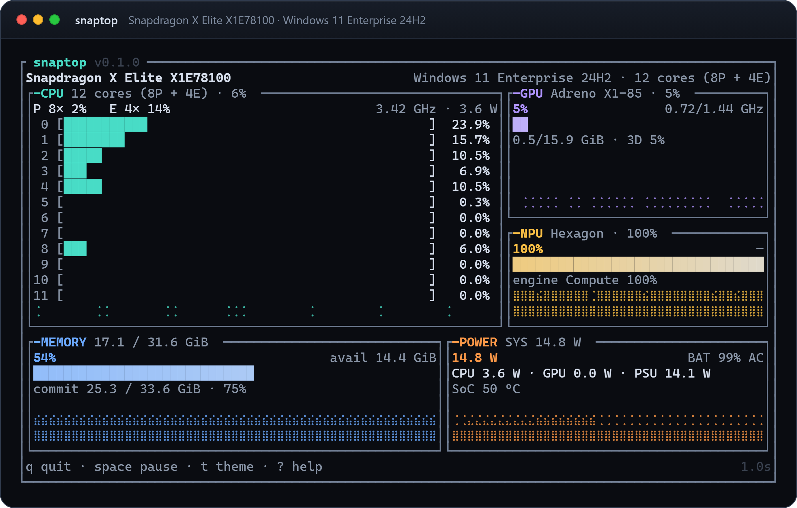

<p align="center"></p>

<p align="center"><strong>snaptop</strong> — a fast, single-binary <code>top</code> for Snapdragon laptops.<br>
CPU, GPU, NPU and power in one clean view. No SDK, no driver.</p>

<p align="center"></p>

<p align="center"><sub>Snapdragon X Elite X1E78100.</sub></p>

## Install

```powershell
winget install 1duo.snaptop
```

Portable ZIP; winget puts `snaptop` on `PATH` and handles upgrades and removal.
The binary is unsigned, so SmartScreen may ask for confirmation. The 0.1.0
manifest will be submitted to `microsoft/winget-pkgs` with the first release —
until it is merged, build from source:

```powershell
git clone https://github.com/1duo/snaptop
cd snaptop
cargo build --release
copy target\release\snaptop.exe "$env:LOCALAPPDATA\Microsoft\WindowsApps\"
```

## Use

```
snaptop                       the dashboard
snaptop --once                one plain-text snapshot
snaptop --json --once         one JSON object
snaptop --json -i 0.5         NDJSON metric stream
snaptop --preview             one frame as text (bug reports)
snaptop --theme <name>        auto, aurora/dark, daylight/light, mono
```

Keys: `q` quit · `space` pause · `+`/`-` speed · `r` reset history · `t` theme · `?` help.

`--theme auto` follows the OS app theme (aurora for dark, daylight for light).
The NPU is the MCDM accelerator Windows exposes as a LUID no DXGI adapter
claims; power comes from the Snapdragon energy-meter rails. Sources and design
notes: [docs/how-it-works.md](docs/how-it-works.md).

## Limits

- Windows only today; the Linux backend is the next milestone.
- Aggregate utilisation — no per-process attribution yet.
- NPU power is shown when the platform exposes a rail; GPU clocks are optional.
- Some systems gate the GPU Engine counters behind an elevated shell.

## License

MIT.
