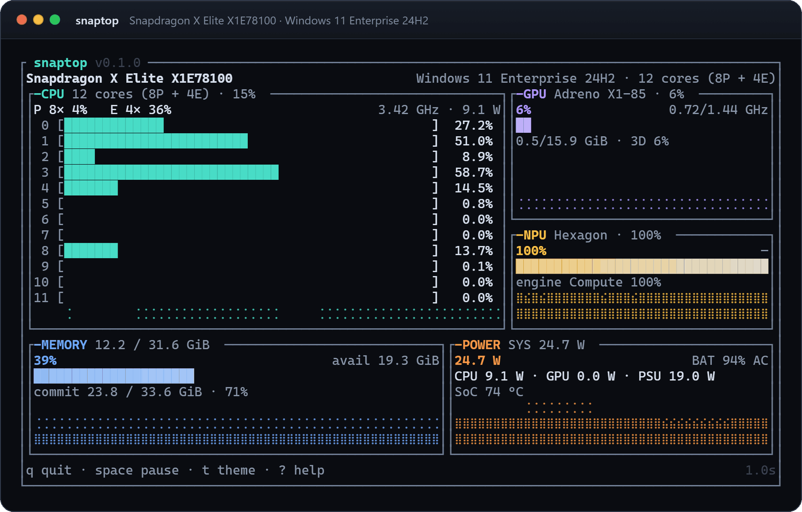

<p align="center"></p>

<p align="center"><strong>snaptop</strong> — a fast, single-binary <code>top</code> for Snapdragon machines.<br>
CPU, GPU, NPU and power in one clean view. No SDK, no driver.</p>

<p align="center"><a href="docs/screenshot.png"></a></p>

<p align="center"><sub>Snapdragon X Elite X1E78100 · click for the 3× still.</sub></p>

## Install

Windows 11 on Arm:

```powershell
winget install 1duo.snaptop
```

Portable ZIP; winget puts `snaptop` on `PATH` and handles upgrades and removal.
The binary is unsigned, so SmartScreen may ask for confirmation. The 0.1.0
manifest will be submitted to `microsoft/winget-pkgs` with the first release —
until it is merged, build from source.

Linux on Arm:

```sh
curl -LO https://github.com/1duo/snaptop/releases/latest/download/snaptop-linux-arm64.tar.gz
tar xzf snaptop-linux-arm64.tar.gz
sudo install snaptop /usr/local/bin
```

A static musl binary with no runtime dependencies. From source, on either OS:

```
git clone https://github.com/1duo/snaptop
cd snaptop
cargo build --release
```

## Use

```
snaptop                       the dashboard
snaptop --once                one plain-text snapshot
snaptop --json --once         one JSON object
snaptop --json -i 0.5         NDJSON metric stream
snaptop --preview             one frame as text (bug reports)
snaptop --theme <name>        auto, aurora/dark, daylight/light, mono
```

Keys: `q` quit · `space` pause · `+`/`-` speed · `r` reset history · `t` theme · `?` help.

`--theme auto` follows the OS app theme (aurora for dark, daylight for light).
On Windows the NPU is the MCDM accelerator a LUID no DXGI adapter claims and
power comes from the Snapdragon energy-meter rails; on Linux everything is a
`/proc` or `/sys` read. Sources and design notes:
[docs/how-it-works.md](docs/how-it-works.md).

## Platforms

| Machine | OS | Notes |
|---|---|---|
| Snapdragon X Elite | Windows 11 Arm | 12 cores, 8P + 4E |
| Snapdragon X2 Elite | Windows 11 Arm | 18 cores, Prime + Performance, no E tier |
| Qualcomm Dragonwing IQ-9075 | Ubuntu 24.04 arm64 | 8 cores, Adreno 663, Hexagon NPU |

All three were verified on hardware.

The Linux backend reads `/proc` and `/sys` only, so other arm64 boards work the
same way; counters a platform does not expose degrade to `—`.

## Limits

- Windows and Linux on Arm64. No macOS or x86 build.
- Linux exposes no system-wide NPU busy counter yet: the row shows its name and
  `—` for utilisation.
- Power rails are Windows-only; Linux reads battery and mains nodes, which
  boards without a battery do not have.
- The Linux GPU row needs kgsl or a DRM busy counter; other GPUs read as absent.
- Aggregate utilisation — no per-process attribution yet.
- Some systems gate the Windows GPU Engine counters behind an elevated shell.

## License

MIT.
